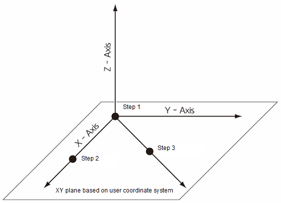
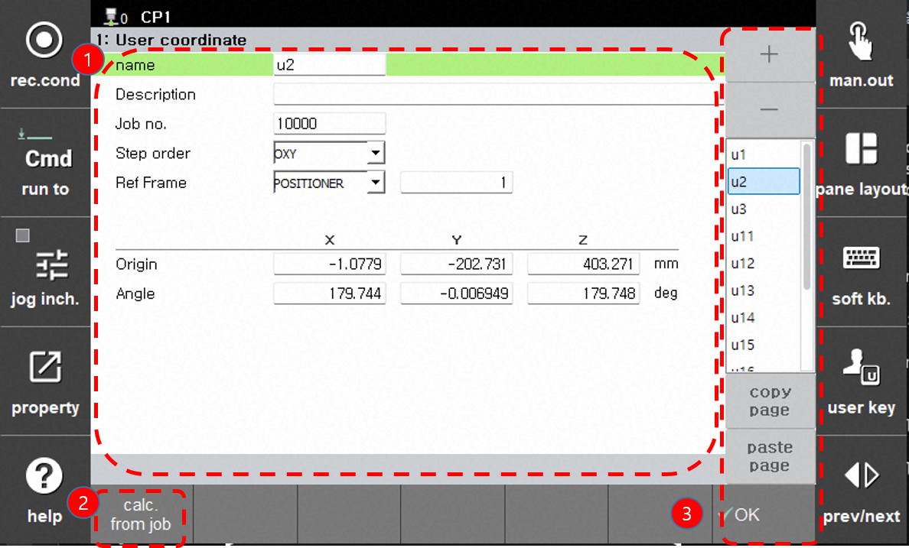

# 7.3.6.1 User Coordinate System

The user coordinate system is a coordinate system that is to be set at a position designated by the user. To use the user coordinate system, first, teach three reference steps that are needed to define the user coordinate system, and then register the user coordinate system by designating the taught program number and step order.

Teach three reference steps by following the procedures below. The following procedure explains when the step order is specified as "OXY" (O: origin pose, X: axis pose, Y: plane pose).

1.	Define the origin of the user coordinate system: Teach an arbitrary point.

2.	Define the X axis in the user coordinate system: Teach an arbitrary point on the X-axis line in a way that the arbitrary point can be 200 mm as distant as possible from the origin.

3.	Define the XY plane in the user coordinate system \(determine the Y-axis and Z-axis directions\): Teach an arbitrary point on the plane consisting of the X axis and Y axis at the point where the distance from the origin is 200 mm or more as possible.


* When the teaching of the user coordinate system setting program is performed, the TCP should be set to the correct values. Check whether the tool data of the currently selected tool is inputted correctly. 
* You can register up to 20 user coordinate systems.




The cautions in recording the reference points for defining the coordinate system are as follows.

* The reference 3 points should not exist on the same linear line.
* The distance between the reference 3 points should not be too close to each other.
* Subsequent steps after S3 will not have any effect on the coordinate system registration.


The method to register the user coordinate system by designating the taught program number and step order is as follows.

1. Touch the `[2: Control Parameter  - 6: Coordinate System Registration  - 1: User Coordinate System]` menu.

2. Go to the user coordinate system you want to register (you can create it with the "+" button).
3. After specifying the program number, step order and reference coordinate system, touch the [calc. from job] button.
4. The calculated origin position and angles of the user coordinate system are displayed.

    

<table>
  <thead>
    <tr>
      <th style="text-align: left;">No.</th>
      <th style="text-align: left;">Description</th>
    </tr>
  </thead>
  <tbody>
    <tr>
      <td style="text-align: left;">
        
      </td>
      <td style="text-align: left;">
        Detailed information on the coordinate system selected from the user coordinate system list. 
        You can set the coordinate system name and description, the taught program number, step order, reference coordinate system and origin position.
        <ul>
          <li><b>[Step order]</b>: Specifies the order of the steps used to define the position and orientation of the user coordinate system. 
            &lt;Origin&gt;&lt;Axis direction&gt;&lt;Coordinate plane&gt; 
            The first step specifies the origin position of the user coordinate system. 
            The second step specifies the direction from the origin along the axis designated in [Step order]. 
            The third step specifies an arbitrary point on the plane designated in [Step order] to define that plane.</li>
          <li><b>[Ref Frame]</b>: Specifies the reference coordinate system used to define the position and orientation of the user coordinate system. 
            Supported in V70.06-00 and later.
            <ul>
              <li><b>[BASE]</b>: Defines the position of the user coordinate system in the base coordinate system. The user coordinate system remains fixed even when the robot or additional axes move.</li>
              <li><b>[ROBOT]</b>: Defines the position of the user coordinate system in the robot coordinate system. When the travel axis moves, the absolute position of the user coordinate system moves with the robot.</li>
              <li><b>[POSITIONER]</b>: Defines the position of the user coordinate system in the positioner coordinate system corresponding to the specified positioner number. The user coordinate system moves with the positioner.</li>
            </ul>
          </li>
        </ul>
      </td>
    </tr>
    <tr>
      <td style="text-align: left;">
        
      </td>
      <td style="text-align: left;">
        Calculates the position of the user coordinate system from the specified job.  
        Enter the taught program number in [Job no.], specify [Step order] and [Ref Frame], and then touch the [calc. from job] button. The origin position and angles of the user coordinate system are calculated and updated on the screen.
        <ul>
          <li><b>[calc. from job]</b>: Calculates the user coordinate system based on the taught program, step order and reference coordinate system information.</li>
        </ul>
      </td>
    </tr>
    <tr>
      <td style="text-align: left;">
        
      </td>
      <td style="text-align: left;">
        <ul>
          <li><b>[OK]</b>: You can save the changes.</li>
          <li><b>[+]/[-]</b>: You can add a new user coordinate system or delete a user
            coordinate system.</li>
          <li>A list of user coordinate systems. Selecting the coordinate system name
            allows you to check and edit details.</li>
          <li><b>[Copy Page]/[Paste Page]</b>: You can copy the user coordinate system
            information and paste it into another coordinate system.
             After selecting the name of the coordinate system information to be copied
            from the list, and then touching the <b>[Copy Page] </b>button, select the
            name of the coordinate system to which the value is to be applied, and
            then touch the <b>[Paste Page]</b> button.</li>
        </ul>
      </td>
    </tr>
  </tbody>
</table>

