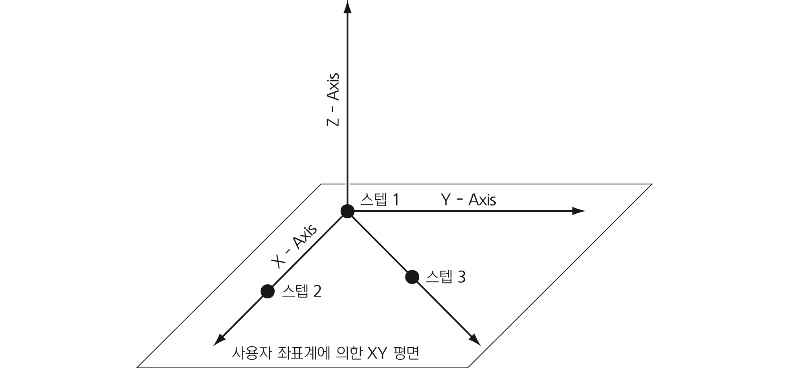
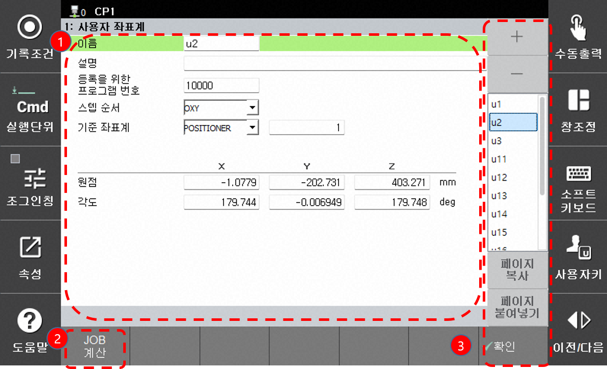

# 7.3.6.1 사용자 좌표계

사용자 좌표계는 사용자\(User\)가 지정하는 위치에 설정하는 좌표계입니다. 사용자 좌표계를 사용하기 위해 먼저 사용자 좌표계 정의를 위한 3개의 기준 스텝을 티칭한 후 티칭된 프로그램 번호와 스텝 순서를 지정하여 사용자 좌표계를 등록합니다.

다음 절차에 따라 3개의 기준 스텝을 티칭하십시오. 하기의 절차는 스텝 순서를 "OXY"로 지정할 때에 대한 설명입니다. (O:원점위치, X:방향위치, Y:평면위치) 



1. 사용자 좌표계의 원점 정의: 임의의 한 점을 티칭하십시오.
2. 사용자 좌표계의 X축 정의: 가능한 한 원점과의 거리가 200 mm 이상 떨어진 지점의 X축 선상에 임의의 한 점을 티칭하십시오.
3. 사용자 좌표계의 XY 평면 정의\(Y축과 Z축 방향 결정\): 가능한 한 원점과의 거리가 200 mm 이상 떨어진 지점의 X축과 Y축으로 이루어지는 평면상에 임의의 한 점을 티칭하십시오.


* 사용자 좌표계 설정용 프로그램을 티칭할 때 TCP \(Tool Center Point\)는 정확한 값으로 설정되어 있어야 합니다. 현재 선택된 툴의 툴 데이터가 정확한 값으로 입력되었는지 확인하십시오.
* 사용자 좌표계는 총 20개까지 등록할 수 있습니다.



좌표계 정의를 위한 기준점 기록 시 주의 사항은 다음과 같습니다.

* 기준 3점이 동일 직선상에 존재하지 않아야 합니다.
* 기준 3점 간의 거리가 지나치게 가깝지 않아야 합니다.
* 사용자 좌표계의 평면을 정의한 S3 이후의 스텝은 좌표계 등록에 아무런 영향을 미치지 않습니다.


티칭된 프로그램 번호와 스텝 순서를 지정하여 사용자 좌표계를 등록하는 방법은 다음과 같습니다.

1. `2: 제어 파라미터 - 6: 좌표계 등록 - 1: 사용자 좌표계` 메뉴를 터치하십시오.
2. 등록을 원하는 사용자 좌표계로 이동합니다. ("+" 버튼으로 생성 가능)
3. 프로그램 번호, 스텝 순서를 지정한 후 [F1:JOB 계산] 버튼을 누릅니다.
4. 계산된 사용자 좌표계 원점의 위치가 표시됩니다.




<table>
  <thead>
    <tr>
      <th style="text-align: left;">번호</th>
      <th style="text-align: left;">설명</th>
    </tr>
  </thead>
  <tbody>
    <tr>
      <td style="text-align: left;">
        
      </td>
      <td style="text-align: left;">
        사용자 좌표계 목록에서 선택한 좌표계의 상세 정보입니다.<br />
        좌표계 이름과 설명, 티칭된 프로그램 번호, 스텝 순서, 베이스 좌표계 기준의 원점의 위치를 설정할 수 있습니다.
        <ul>
          <li>[스텝 순서]: 사용자 좌표계 위치 및 방향 생성을 위한 스텝의 구성 순서를 지정 합니다.<br/>
          <원점><좌표계 방향><좌표계 평면><br/> 
           첫번째 스텝은 사용자 좌표계 원점 위치를 지정 합니다.<br/> 
           두번째 스텝은 사용자 좌표계 원점 으로 부터 스텝 순서에 지정된 방향을 지정 합니다.<br/> 
           세번째 스텝은 [스텝 순서]에 지정된 평면을 정의 하기위해 해당 평면상의 임의 위치를 지정 합니다.<br/></li>
        </ul>
        <ul>
          <li>[기준 좌표계]: 사용자 좌표계 위치 및 방향을 정의하는 기준 좌표계를 지정 합니다.<br/>
          - V70.06-00 이상 버전에서 지원<br/>
           [BASE] : 베이스 좌표계 상에서 사용자 좌표계 위치를 정의합니다. 로봇 또는 부가축의 이동에도 사용자 좌표계 위치가 변하지 않습니다.<br/>
           [ROBOT] : 로봇좌표계 상에서 사용자 좌표계 위치를 정의 합니다. 주행축이 움직일 경우 사용자 좌표계의 절대 위치가 로봇과 함께 이동 합니다.<br/> 
           [POSITIONER] 지정된 포지셔너 번호에 해당하는 포지셔너 좌표계 상에 사용자 좌표계의 위치가 정의 됩니다. 포지셔너 이동 시 사용자 좌표계의 위치가 포지셔너와 함께 움직입니다.<br/></li>
        </ul>
      </td>
    </tr>
    <tr>
      <td style="text-align: left;">
        
      </td>
      <td style="text-align: left;">
        사용자 좌표계 위치를 지정된 JOB으로부터 계산합니다.<br /><br />
        [등록을 위한 프로그램 번호] 옵션에 티칭한 프로그램의 번호를 입력하고 스텝 순서와 기준 좌표계를 지정한 후 [JOB 계산] 버튼을 터치하면 사용자 좌표계의 원점과 각도가 계산되어 화면에 갱신 됩니다.
        <ul>
          <li>[JOB 계산]: 사용자 좌표계를 정의하기 위해 티칭한 프로그램과 스텝 순서 기준 좌표계 정보에 따라 사용자 좌표계를 계산합니다.</li>
        </ul>
      </td>
    </tr>
    <tr>
      <td style="text-align: left;">
        
      </td>
      <td style="text-align: left;">
        <ul>
          <li>[확인]: 변경 내용을 저장합니다.</li>
          <li>[+]/[-]: 새로운 사용자 좌표계를 추가하거나 사용자 좌표계를 삭제합니다.</li>
          <li>사용자 좌표계 목록입니다. 좌표계 이름을 선택하면 상세 정보를 확인 및 편집할 수 있습니다.</li>
          <li>
            [페이지 복사]/[페이지 붙여넣기]: 사용자 좌표계 정보를 복사하여 다른 좌표계에 붙여 넣습니다.<br />
            목록에서 복사할 좌표계 정보의 이름을 선택하고 [페이지 복사] 버튼을 터치한 후 값을 적용할 좌표계의 이름을 선택하고 [페이지 붙여넣기] 버튼을 터치하십시오.
          </li>
        </ul>
      </td>
    </tr>
  </tbody>
</table>
```
