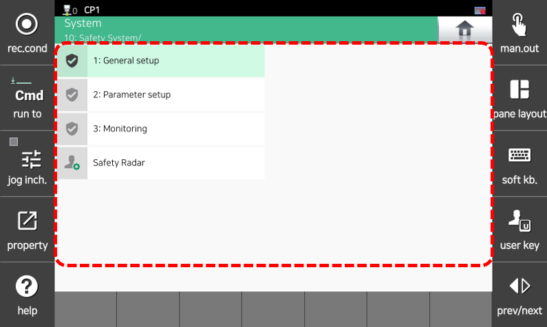



# 7.8 안전 시스템


이 기능은 Hi7 제어기부터 지원됩니다.


1.	\[8: 안전 시스템\] 메뉴를 터치하십시오. 안전 시스템 메뉴가 나타납니다.

2.	원하는 메뉴를 선택하여 기본 설정, 파라미터 설정, 모니터링, 인증서, 안전 레이더를 수행하십시오.


안전 시스템의 1:기본 설정, 2: 파라미터 설정, 3: 모니터링, 4: 인증서에 대한 자세한 관한 내용은  "[SafeSpace2.0 안전 기능 설명서](https://hrbook-hrc.web.app/#/view/doc-safespace2.0/ko/README)"을 참고하십시오.



안전 레이더에 대한 자세한 관한 내용은  "[레이더 객체 감지 시스템](https://hrbook-hrc.web.app/#/view/doc-Object-Detection-System/ko/README?cont_model=${cont_model})"을 참고하십시오.
